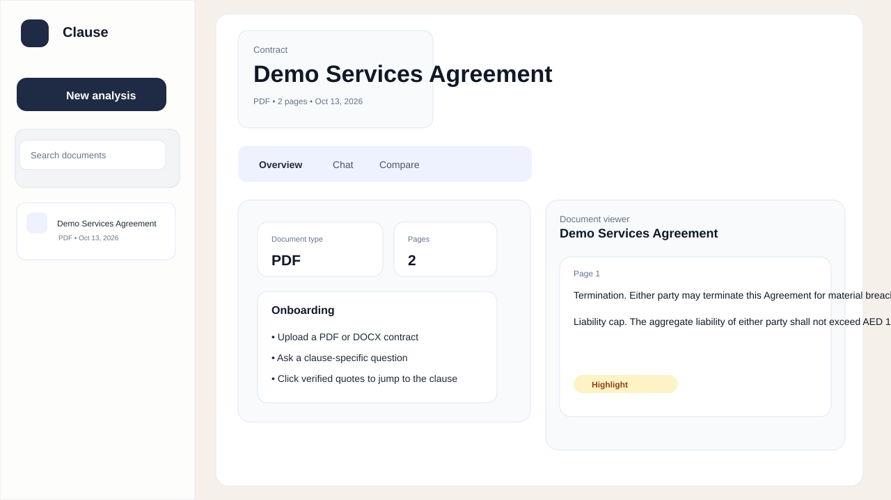
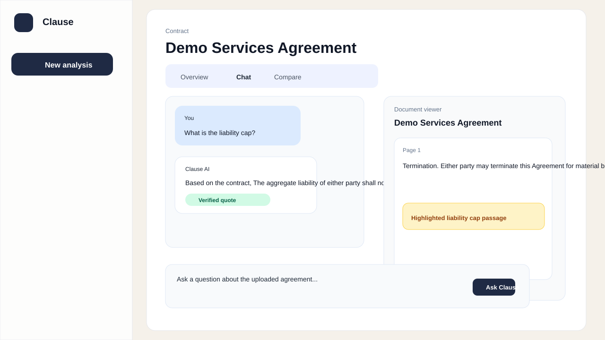
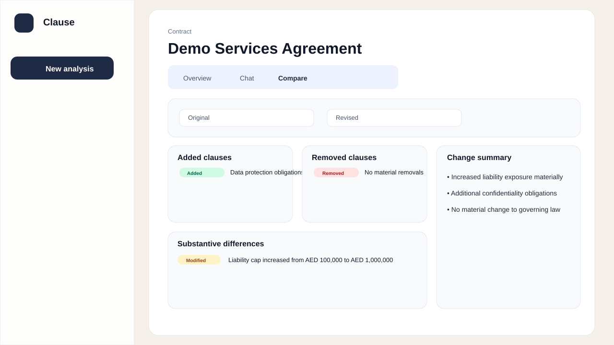

# Clause — Contract Analysis Workspace

Clause is a legal contract analysis workspace focused on evidence-first answers. It accepts PDF and DOCX uploads, extracts text, stores document metadata locally in the browser, and lets the user ask contract-specific questions while preserving verified quotes from the source text.

## What the app does

- Accepts PDF and DOCX uploads only
- Rejects unsupported file types with clear validation errors
- Extracts plain text from searchable PDFs and DOCX files
- Detects unreadable scanned PDFs and surfaces a failure instead of reporting success
- Lists uploaded documents with status, metadata, and delete actions
- Lets the user ask questions from the contract and streams the answer in the UI
- Verifies that each supporting quote actually exists in the extracted text before presenting it as genuine
- Opens the relevant document passage when the user clicks a verified quote
- Compares two uploaded document versions and highlights likely clause-level differences
- Uses deterministic retrieval logic and local persistence to keep the workflow working without a server secret or API key

## Screenshots

### Upload and document library



### Chat with verified quotes



### Document comparison



## How to run locally

1. Open the project folder:
   ```bash
   cd contract-analyser
   ```
2. Install dependencies:
   ```bash
   npm install
   ```
3. Start the dev server:
   ```bash
   npm run dev -- --host 0.0.0.0
   ```
4. Open the app in your browser:
   ```text
   http://localhost:5173/
   ```

## What is finished

- Premium three-panel contract workspace UI
- Local upload flow for PDF and DOCX files
- Real PDF and DOCX text extraction
- Document processing status and validation states
- Chat workflow with streaming answer generation
- Deterministic quote verification using whitespace-normalized matching
- Citation highlighting by matching the quote back to the page text
- Clause-level comparison using extracted text segmentation
- Local persistence in browser storage for reopened sessions

## What is not finished

- No production backend or PostgreSQL persistence
- No real AI provider integration with a server-side API route
- No full multi-document agentic research loop or tool-calling model orchestration
- No deployment to Vercel or Railway yet
- No full PDF page-to-text anchoring down to exact rendered coordinates for every legal formatting case

## Part C choice: Option 2 — Agentic document research

I selected Option 2 because it is the most realistic fit for a document-analysis assistant: a bounded retrieval loop that decides which clauses to inspect before answering. I implemented the local evidence-first retrieval and quote verification layer, but the full multi-round tool-calling orchestration was intentionally left as the next step because it requires a server-backed AI agent and more robust tool validation than the current local browser prototype.

The hardest part is keeping tool usage deterministic, bounded, and auditable while still preserving evidence. The app therefore uses a controlled retrieval strategy and explicit quote checking rather than trusting free-form model output.

## Limitations and next steps

- The app is designed for local browser use and works best with a single-user contract workflow.
- Large-document chunk retrieval and semantic search are not yet implemented at the server level.
- The next practical improvement would be adding a Next.js API layer with a provider-based AI route, persisted SQLite storage, and a bounded tool-calling agent that can search and summarize clauses safely.
